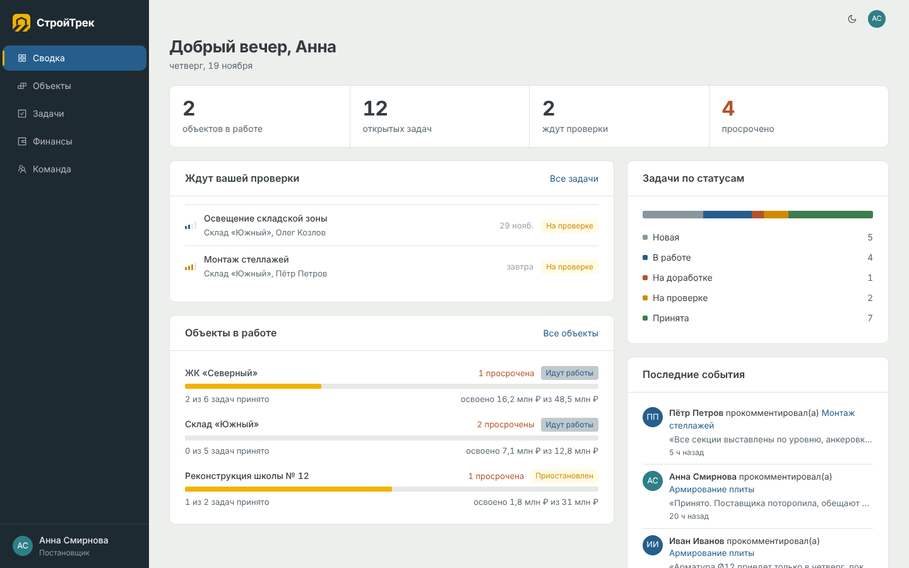
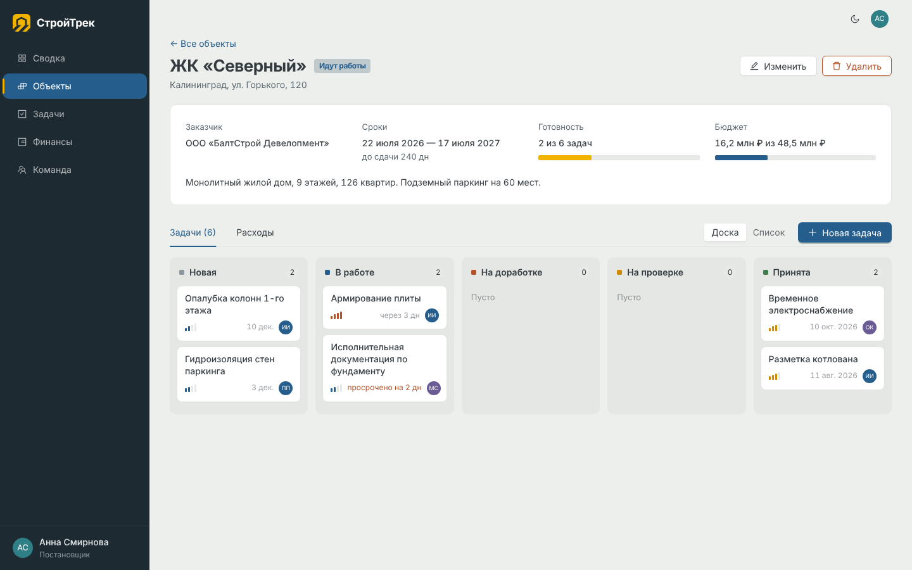
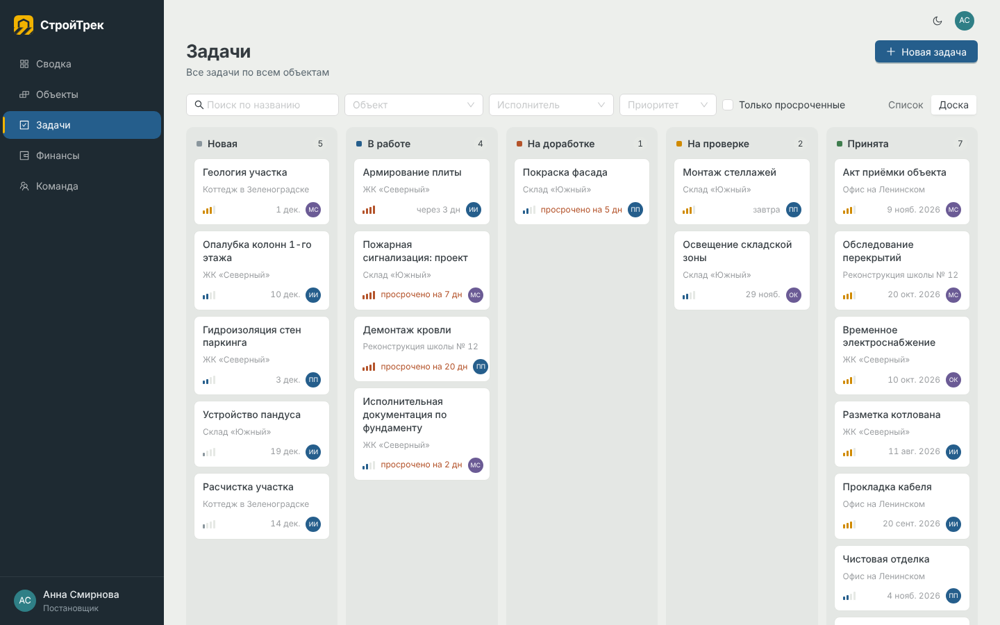
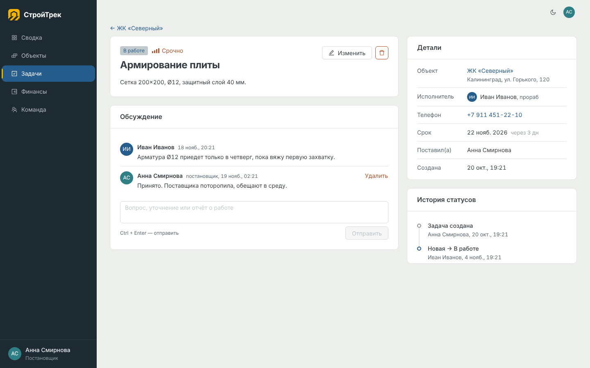
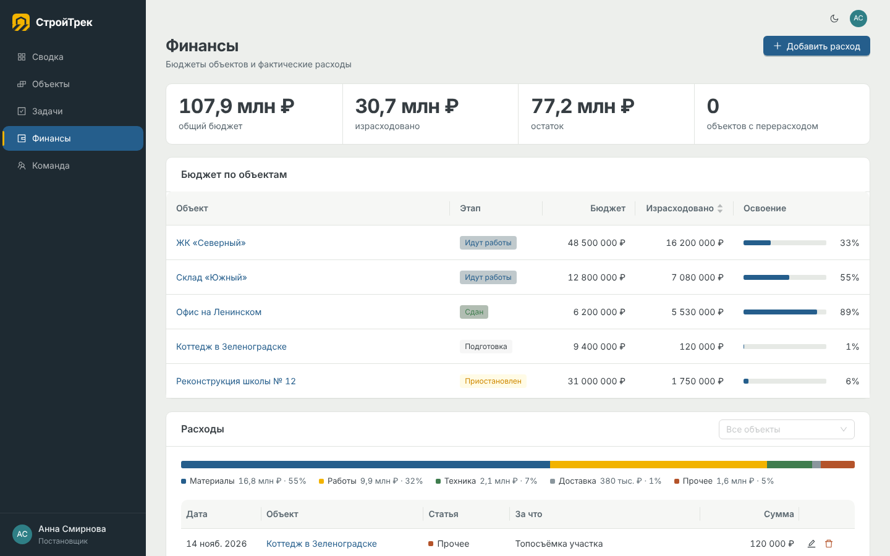
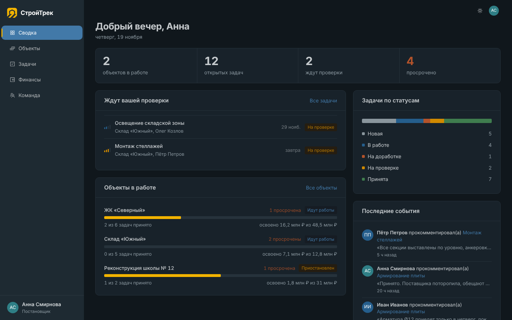

# СтройТрек — CRM для строительной компании

Объекты, задачи бригадам, сроки и расходы в одном окне. Постановщик заводит стройки, ставит задачи
исполнителям, принимает работу и следит за бюджетом. Исполнитель видит только свои задачи, берёт их
в работу, сдаёт на проверку и обсуждает детали в комментариях.

Все права доступа, переходы статусов, история и финансы защищены **на уровне базы** (RLS, гранты на колонки,
триггеры), поэтому работают и при обращении к Supabase напрямую, в обход интерфейса.

- Демо: https://construction-crm-sereda.netlify.app
- Как устроено простыми словами: [docs/for-manager.md](docs/for-manager.md)
- Решения и допущения: [docs/decisions.md](docs/decisions.md)
- Первая версия (тестовое задание) сохранена в ветке [`test-assignment`](../../tree/test-assignment)



## Возможности

**Сводка.** Ключевые показатели (объекты в работе, открытые задачи, ждут проверки, просрочено), задачи,
которые ждут решения именно этого пользователя, готовность объектов и освоение бюджета, лента последних событий.

**Объекты.** Этап (подготовка, идут работы, приостановлен, сдан), заказчик, адрес, сроки, бюджет.
Готовность считается по принятым задачам, освоение — по фактическим расходам. Карточки или таблица,
фильтр по этапу и поиск сохраняются в адресе страницы.

**Задачи.** Приоритет, срок с подсветкой просрочки, исполнитель. Общий список с фильтрами по объекту,
исполнителю, статусу, приоритету и просрочке. Канбан-доска: карточку можно перетащить только в тот статус,
который разрешён этому пользователю, — доска подсвечивает допустимые колонки. Возврат на доработку
требует комментарий.

**Карточка задачи.** Обсуждение (комментарии видят только те, кто видит задачу), контакты исполнителя,
история статусов с комментариями.

**Финансы** (только постановщик). Бюджет и факт по каждому объекту, перерасход, журнал расходов по статьям:
материалы, работы, техника, доставка, прочее.

**Команда** (только постановщик). Загрузка каждого исполнителя по статусам, просрочки, контакты.

**Профиль.** Имя, должность, телефон; светлая и тёмная тема. Интерфейс адаптирован под телефон.

| | |
|---|---|
|  |  |
|  |  |
|  |  |

## Стек

React 19, TypeScript, Vite, Ant Design 6, React Router 7, Supabase (Postgres, Auth, RLS).
Тесты: SQL-тесты доступа на PostgreSQL, сквозной сценарий в браузере на Playwright.

## Как устроена защита

| Требование | Как сделано | Где |
|---|---|---|
| Права закрыты в базе | RLS на всех таблицах; anon не имеет прав ни на что | `003_rls.sql`, `005_mvp_domain.sql` |
| Исполнитель не видит и не меняет чужое | `tasks_select`: постановщик или `assignee_id = auth.uid()`; запись — только постановщик | `003_rls.sql` |
| Переходы статусов проверяет база | Колонку `status` нельзя обновить напрямую (нет гранта). Смена — только через RPC `change_task_status`, правила — в триггере `tasks_before_update` | `002_status_machine.sql` |
| Историю нельзя подделать | На `task_history` выдан только `select`; пишет её только триггер | `002`, `003` |
| Комментарии — только к своим задачам | Политики `task_comments_*`; автор и время проставляются триггером; удалить можно только свой | `005_mvp_domain.sql` |
| Финансы видит только постановщик | Политики `expenses_*`; сводка `object_summary` с `security_invoker`, поэтому исполнитель видит в ней только свои задачи и нулевые суммы | `005_mvp_domain.sql` |
| Роль не повысить | Сотрудник может менять в профиле только имя, телефон и должность (гранты на колонки + RLS на свою строку) | `005_mvp_domain.sql` |
| Регистрация закрыта | Настройка Supabase Auth + роль по умолчанию «исполнитель» | README, `001_schema.sql` |
| Секреты не во фронте | Во фронте только URL и anon/publishable ключ; `.env` в `.gitignore` | `.env.example` |

## Запуск

### 1. База (Supabase)

1. Создать проект на [supabase.com](https://supabase.com) (бесплатный тариф).
2. SQL Editor → выполнить по порядку файлы из `supabase/migrations/`
   (или `npx supabase link --project-ref <ref> && npx supabase db push`).
3. Authentication → Sign In / Providers → выключить **Allow new users to sign up**.
4. Authentication → Users → Add user (Auto Confirm): `manager@example.com`, `ivanov@example.com`, `petrov@example.com`,
   по желанию ещё `kozlov@example.com` и `sokolova@example.com` (без них их задачи достанутся Иванову и Петрову).
5. SQL Editor → выполнить `supabase/seed.sql`: роли, 5 объектов, 19 задач во всех статусах с историей за полгода,
   комментарии и расходы.

Если база уже развёрнута с первой версии, достаточно выполнить новую миграцию
`20261119000005_mvp_domain.sql` — старые данные сохранятся, у объектов появится этап «Подготовка»,
у задач — обычный приоритет.

### 2. Фронт

```bash
cp .env.example .env   # вписать URL и anon/publishable ключ из Project Settings → API
npm install
npm run dev
```

`VITE_DEMO_PASSWORD` — необязательный пароль демо-пользователей: если он задан, на экране входа появятся
кнопки «Постановщик» и «Исполнитель» для быстрого входа. Для рабочей системы его не задают.

### 3. Проверки

**Тесты базы** (91 проверка):

```bash
PGHOST=localhost PGUSER=postgres npm run test:db
```

Тест входит от имени постановщика, двух исполнителей и анонима и проверяет, что запрещённое запрещено:
чтение и изменение чужих задач, запрещённые переходы, подделка и удаление истории, повышение роли,
доступ исполнителя к расходам, комментарии к чужим задачам и от чужого имени.

**Сквозной сценарий в браузере** (36 проверок, Playwright) на локальной копии Supabase:
`PGHOST=localhost PGUSER=postgres ./e2e/run.sh`. Подробнее — [e2e/README.md](e2e/README.md).

## Структура

```
supabase/migrations/   001 схема · 002 статусы и история · 003 гранты и RLS · 004 служебные функции
                       005 этапы и бюджет объектов, приоритеты и сроки, комментарии, расходы, профиль
supabase/seed.sql      демо-данные
supabase/tests/        тесты доступа
e2e/                   локальная копия Supabase + браузерный сценарий всех ролей
src/api/               запросы к базе, типы базы (контракт фронт ↔ база), подписи статусов
src/auth/              сессия и профиль текущего пользователя
src/theme/             цвета, шрифт, светлая и тёмная тема
src/lib/taskActions.ts какие действия показать (зеркало правил базы, только для UI)
src/hooks/             загрузка данных, смена статуса с комментарием
src/pages/             сводка, объекты, задачи, финансы, команда, профиль
src/components/        раскладка, доска задач, формы, обсуждение, таблицы
docs/                  решения и допущения, объяснение для руководителя, скриншоты
```
